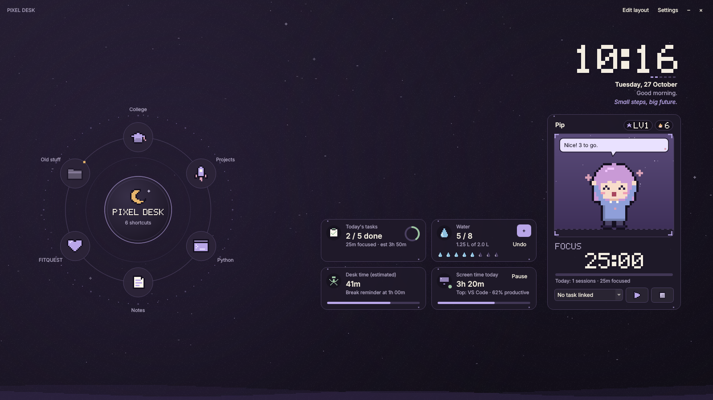
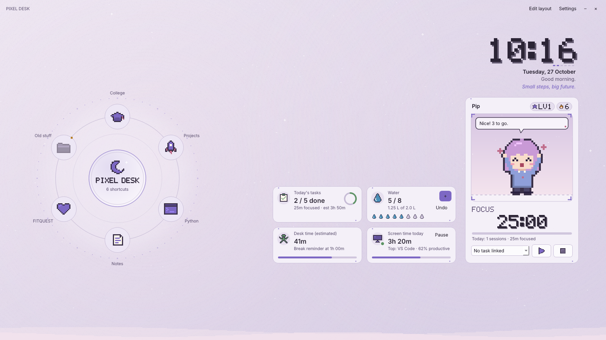
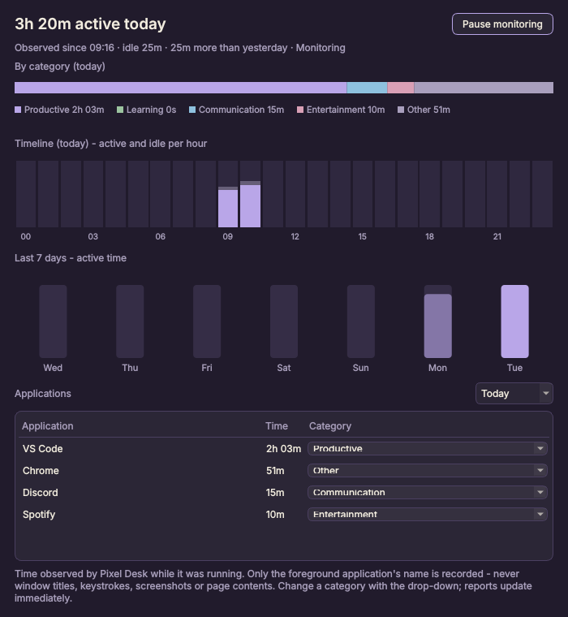

# Pixel Desk

A cozy, slightly gamified desktop companion for Windows 11: a radial folder launcher, a small pixel-art
friend with a focus timer, and a few quiet widgets for tasks, water, movement breaks and screen time.
Everything is stored locally. There are no accounts and nothing is sent to the cloud.



| Muted pastel theme | Screen-time report |
|---|---|
|  |  |

The companion, **Pip**, is original pixel art drawn in code ([sprite sheet](docs/pip_sprite_sheet.png)).

---

## Quick start (Windows 11, PowerShell)

Requires Python 3.10 or newer (3.12 recommended), from <https://www.python.org/downloads/>.

```powershell
cd PixelDesk
.\scripts\setup_dev.ps1      # creates .venv and installs the dependencies (only needed once)
.\scripts\run_dev.ps1        # starts Pixel Desk in desktop-companion mode
.\scripts\run_dev.ps1 -Window   # or start this session in a normal window
```

If scripts are blocked, run this once in the same PowerShell window:
`Set-ExecutionPolicy -Scope Process -ExecutionPolicy Bypass`.

To do the same thing by hand:

```powershell
py -3.12 -m venv .venv
.\.venv\Scripts\Activate.ps1
pip install -r requirements.txt
python main.py            # add --window for window mode, --verbose for debug logs
```

### Build a Windows executable

```powershell
.\scripts\build_windows.ps1          # runs the tests, then PyInstaller
# output: dist\PixelDesk\PixelDesk.exe  (copy the whole dist\PixelDesk folder anywhere)
```

The build uses `pixeldesk.spec`. User data is never stored next to the executable (see *Your data*).

### Run the tests

```powershell
.\scripts\run_tests.ps1
# or: $env:QT_QPA_PLATFORM="offscreen"; .\.venv\Scripts\python -m pytest -v
```

Windows APIs are mocked, so the suite also runs on macOS and Linux (`QT_QPA_PLATFORM=offscreen python -m pytest`).

---

## What it does

### Radial launcher (left)
* A custom-painted wheel of your folders, shortcuts and apps around a moon hub. Items grow and glow on hover,
  a selection arc eases toward the focused item and the wheel settles in with one short rotation on start.
  It never spins continuously.
* **Click** opens the folder in File Explorer or launches the app/`.lnk`/`.exe`. Hover tooltips show the full path.
* **Keyboard:** Tab to focus the wheel, then use the arrow keys, Home/End, and Enter/Space. The Menu key opens the item menu.
* **Right-click an item:** Open, Open containing folder, Edit, Move clockwise or counter-clockwise, Remove from wheel.
  **Right-click the hub:** Add folder… / Add application… (native pickers) / Edit wheel….
* On first run the wheel only contains standard folders that actually exist (Desktop, Documents, Downloads,
  Pictures, Screenshots…). Names such as *College, Projects, Python, Notes, FITQUEST* are offered as
  suggestions in the Add dialog. Pixel Desk makes no assumptions about how your folders are organised.
* Missing or inaccessible paths are dimmed, marked, and explained. Nothing crashes.
* **File safety:** Pixel Desk only stores shortcuts. It never moves, renames, deletes or scans your files. Launching
  uses `os.startfile` (ShellExecute) on a validated path. No shell command strings are built, so a label can
  never be executed.

### Pip, the companion, with the focus timer (right)
* States: idle (breathing and blinking), working (typing at a laptop during focus), happy (task done), sleepy
  (idle, locked, or between 1 and 5 am), hydration (sipping water), movement (stretching and walking in place),
  and achievement (holding a star).
* Click Pip for a friendly line and a wave. Click the speech bubble to open the related section. Click the
  streak or level chips to open Streaks & habits.
* Messages are short and encouraging. There is no guilt, no "you broke your streak", and no dark patterns.
  Animations and messages can each be turned off, sounds are off by default, and there is a reduced-motion
  mode.
* **Focus timer:** 25/5 by default (configurable), with start, pause, resume and reset. You can link a session
  to a task, and breaks can start automatically. Elapsed time comes from a monotonic clock, so the timer does
  not drift. Each session has a unique id, so it is saved exactly once. A reset session of a minute or more is
  stored as *cancelled*: its minutes count as focus time for the task, but it gets no completion credit or XP.

### Clock (upper right)
Live local time in a bitmap pixel font (also original, drawn in code), the date, a time-of-day greeting with
your optional name, and a rotating message you can edit. Click it to show the next message.

### Utility tiles (lower right)
* **Tasks:** done/total for today with a progress ring. Opens a full task manager where you can add, edit,
  delete, complete and reopen tasks. Each task can have a priority, an estimate, a due date and a category.
  You can reorder tasks, see To do and Completed separately, start a focus session on the selected task,
  compare estimate vs recorded focus time, and read an end-of-day summary. Tasks due later are shown as
  *upcoming*. The task list starts empty.
* **Water:** one-click **+** to log a serving, **Undo** for the last entry, progress drops, and a 14-day
  history. You can set the goal, serving size, reminder interval, snooze and quiet hours. The default of
  8 servings is labelled as a common default, not medical advice.
* **Movement:** shows estimated active desk time. After 60 active minutes (configurable) you get a reminder
  with **Start 5-minute break**, **Remind me later** and **Dismiss**. A break shows a countdown and no
  reminders appear while it runs. A completed break resets the interval. Using the computer for the
  idle-reset period (5 minutes by default) also resets it. The tile clearly says this is an *estimate*:
  Pixel Desk cannot know whether you are sitting or walking.
* **Screen time:** active time today, the top app, the share of productive time, a monitoring status dot,
  and a Pause button. The report shows categories, an hourly active/idle timeline, the last 7 days, the
  change versus yesterday, and per-app time with editable categories.

### Screen-time monitoring
* A background thread polls the **foreground window's process name** (`GetForegroundWindow` and psutil) and
  the **time since last input** (`GetLastInputInfo`) once per second. It never records window titles,
  keystrokes, typed text, screenshots or page contents.
* **Idle handling:** time after your last input is held as *pending*. If you come back before the idle
  threshold (5 minutes by default, configurable), it counts as active, which covers reading or watching a
  video. If the threshold is reached, that whole input-free stretch is reclassified as **idle** and is never
  counted as app usage.
* Locked sessions, sleep and suspend (detected as gaps between polls) and clock changes are excluded. Each
  second is written once, in batched transactions every 30 seconds and on exit or sign-out.
* Categories (productive, learning, communication, entertainment, other) start from a small editable
  table. Browsers default to *other*: they are not assumed to be unproductive.
* Everything is labelled as **time observed by Pixel Desk**. If Pixel Desk starts at 2 pm, no usage is
  invented for the morning. A status indicator shows *Monitoring*, *Idle*, *Locked*, *Paused* or
  *Unavailable*. You can pause from the tile, the tray, or Settings.

### Streaks, XP and badges
* Habits are yours to define, and four editable defaults are added on first run. For each habit you choose
  whether it counts toward the overall streak.
* You get the current streak, the longest streak, per-habit streaks, a weekly completion percentage and a
  monthly heatmap. **Today being unfinished never breaks a streak.** A streak only ends after a whole day
  with no check-in.
* Optional XP and levels. Each award is keyed by its source (task id, habit plus day, session id, and so
  on), so checking an item repeatedly can never award XP twice. Reopening a task removes its XP. There are
  ten badges to unlock.

### Desktop integration
**Desktop companion mode** (the default on Windows): each widget is its own small, frameless, translucent
tool window.
* Every widget window is *owned by the window that hosts the desktop icons* and pinned to the bottom of the
  z-order. That puts it directly above the icons and below every application, and it stays visible with
  "Show desktop".
* Desktop icons that aren't under a widget stay visible and clickable. Use **Edit layout** (tray, right-click
  menu or Settings) to drag widgets away from your icons. Positions are saved as fractions of the screen, so
  they survive resolution and scaling changes.
* The taskbar is never covered, because widgets are placed inside the screen's available area.

**Background options** (Settings › General):
* *Keep my current wallpaper* (default).
* *Use the Pixel Desk background as wallpaper* (recommended): Pixel Desk renders the gradient at your screen's
  resolution and sets it as the wallpaper. Your previous wallpaper is remembered and restored when you switch
  back.
* *Live layer behind icons* (experimental): Pixel Desk asks Explorer for the WorkerW layer between the
  wallpaper and the icons (both the classic layout and the Windows 11 24H2+ layout are handled) and paints
  the background there. Anything in that layer can't receive clicks, because Windows sends desktop mouse
  input to the icon view. That is why only the background lives there and never the widgets. A watchdog
  re-attaches after an Explorer restart.

**Window mode:** the same dashboard in one frameless, resizable window. Drag empty space to move it, drag the
edges to resize, and double-click to maximise. It is used automatically if desktop integration fails, and it
is the only mode on non-Windows systems.

Also included: a tray icon (left-click hides or shows the widgets; the menu has quick actions, pause
monitoring, switch mode and quit), Windows toast notifications with an in-app fallback, a **single
instance** (launching again just shows the running copy), and **Start with Windows**. That last option is
off by default. It writes one value under `HKCU\…\CurrentVersion\Run`. To remove it, untick the setting or
disable *PixelDesk* in Task Manager › Startup apps. Explorer restarts and monitor or DPI changes are handled.

---

## Your data

| What | Where |
|---|---|
| Database (SQLite, WAL) | `%LOCALAPPDATA%\PixelDesk\pixeldesk.db` |
| Logs (rotating) | `%LOCALAPPDATA%\PixelDesk\logs\` |
| Backups (default folder) | `%LOCALAPPDATA%\PixelDesk\backups\` |

* The schema is versioned (`PRAGMA user_version`). Migrations run once each, inside transactions, so upgrades
  keep your data.
* The database uses foreign keys, CHECK constraints, unique keys that stop duplicate events (one completion
  per task, one check-in per habit per day, one row per focus-session id, one XP grant per source), and
  indexes.
* Dates are local ISO dates. Timestamps are ISO-8601 with a UTC offset.
* **Backup and restore:** Settings › Data. Backups use SQLite's online backup API. A restore checks the file
  first, keeps a safety copy of your current data, and restarts the app.
* **Retention:** per-app and hourly detail is kept for 180 days by default (configurable). Daily totals are
  kept.
* Override the data folder with the `PIXELDESK_DATA_DIR` environment variable (the tests use this).

---

## Project layout

```
main.py                     entry point (single instance, logging, Qt app)
app/                        orchestration: application.py, config.py, settings_store.py, context.py, clock.py
database/                   connection.py (thread-safe SQLite), schema.py (migrations), repository.py (all SQL)
services/                   pure logic + Qt controllers
  activity_monitor.py       aggregation (idle reclassification, sleep/lock exclusion) + monitor QThread
  idle_detector.py, app_catalog.py, focus_timer.py, reminder_service.py, wellbeing_controller.py,
  streak_service.py, launcher_service.py, startup_service.py, notification_service.py
winintegration/             the only Windows-specific code (ctypes): api.py, probe.py, desktop_layer.py
ui/                         theme.py, pixel_art.py (icons, font, sprites), background.py, panel.py,
                            radial_wheel.py, character_panel.py, clock_widget.py, task/water/movement/
                            screen_time/streak widgets, charts.py, settings_dialog.py, desktop_shell.py
assets/                     generated app icon (.ico/.png), reference sprite + icon sheets
scripts/                    setup_dev.ps1, run_dev.ps1, run_tests.ps1, build_windows.ps1, generate_assets.py
tests/                      81 automated tests
```

Dependencies: **PySide6** and **psutil** at runtime, plus **pytest** and **PyInstaller** for development.
pywin32 and Pillow are not needed. The few Win32 calls go through `ctypes`, and the pixel art is drawn
with Qt.

---

## Test results

Run in a Linux container (Python 3.13.17, PySide6 6.12.0, Qt offscreen platform, Windows APIs mocked):

```
$ QT_QPA_PLATFORM=offscreen python -m pytest -v
============================== 81 passed in 9.02s ==============================
```

| File | What it covers |
|---|---|
| `test_database.py` (15) | migrations, task create/edit/delete, completion exactly once, day partitioning, reorder, water and undo, focus de-duplication, XP de-duplication, persistence across restart, nested settings merge, backup/validate/restore, launcher CRUD, habit uniqueness |
| `test_streaks.py` (12) | consecutive days, late-in-the-day rule, missing days, longest streak, month, year and leap-day boundaries, weekly rates, month grid, levels, no duplicate XP, configurable streak habits, achievements unlock once |
| `test_activity_aggregation.py` (10) | no double counting, idle reclassification, short pauses stay active, locked time excluded, sleep gaps and backwards clock changes, hour/midnight splitting, DB aggregates, browsers not assumed unproductive, monitor thread with a mock probe, unavailable probe records nothing |
| `test_reminders.py` (12) | quiet hours across midnight, water interval, snooze, logging, goal and quiet hours, movement after one hour, idle reset, snooze, break flow with no reminders during a break, dismiss/cancel, sleep gaps, inactive time |
| `test_focus_timer.py` (7) | completion, pause/resume, no drift, cancellation without credit, recorded once, auto-start break, Qt controller persists the session and awards XP |
| `test_launcher.py` (7) | missing paths, wrong types, empty or NUL paths, the opener is only called for valid paths, OS errors reported, labels never executed |
| `test_app_startup.py` (13) | full app start and config loading, restart persistence, monitor → DB, pause status, wheel with invalid paths, wheel keyboard, water goal XP, movement signal, every dialog opens, every theme, default layout has no overlaps, single instance, panel click handling |
| `test_startup.py` (2), `test_pixel_art.py` (3) | registry Run key with a fake `winreg`; icon, font and sprite integrity |

Also verified in the container: the app ran end to end headless with a mock probe (screenshots above).
A **PyInstaller build** of `pixeldesk.spec` completed. The frozen binary started, created its database in the
data folder, and handed off to the running copy on a second launch. Ctrl+C triggered a clean, saving
shutdown.

### Manual Windows smoke test (not yet performed: requires a Windows 11 machine)

The development environment for this build had no Windows machine, so these checks still need to be done
by hand:

1. Run `.\scripts\run_dev.ps1`. Widgets should appear above the desktop icons and below open apps. Click an
   app window, then click a widget: the app window must stay on top of the widget.
2. Desktop icons not covered by a widget can be clicked, dragged and double-clicked. The taskbar is never
   covered.
3. Press **Win+D**. The widgets should remain visible.
4. Click wheel items. Folders should open in Explorer and `.lnk`/`.exe` items should launch. A deleted
   folder should show the "no longer exists" message.
5. Screen time: use two apps for a few minutes, then leave the PC alone for more than 5 minutes. The report
   should show both apps, and the idle time should appear only as idle. Lock the PC with Win+L for a minute:
   that time must not be counted.
6. Notifications: set the water interval to 10 minutes and turn off quiet hours. A Windows toast should
   appear.
7. Settings › General › *Use the Pixel Desk background as wallpaper*, then switch back. The original
   wallpaper should return. Try *Live layer*, then restart Explorer from Task Manager: the background should
   re-attach within about 5 seconds.
8. Tick *Start with Windows*, sign out and back in, then untick it.
9. Change the display scaling (100% → 150%) and connect or disconnect a monitor. Widgets should stay on
   screen.

---

## Limitations and notes

* **Not yet tested on Windows by hand.** All logic is covered by automated tests with the Windows APIs
  mocked, and the UI was exercised headless. The Win32 code paths (`winintegration/`) have only been
  reviewed, not run. Use the checklist above. If anything misbehaves, `--window` and Settings › Display
  mode › *Normal window* keep everything working.
* **Behind-the-icons widgets aren't possible.** Interactive widgets sit *above* the icon layer, so a widget
  hides the icons beneath it. Place widgets away from your icons. The wheel defaults to the left, where
  Windows puts icons, so move one or the other with Edit layout.
* The **live background layer** relies on undocumented Explorer behaviour (the WorkerW message). It is
  marked experimental. The wallpaper option is the robust alternative.
* **Movement reminders estimate desk time** from input activity. If idle detection is unavailable, the time
  Pixel Desk has been running is used, and the tile says so.
* Screen time is time **observed while Pixel Desk runs**. Apps running as administrator may show as
  "Unknown" names if Windows denies process access. Full-screen games may also look idle when they read
  input through raw APIs.
* Native notifications go through the tray icon (`QSystemTrayIcon`). They appear as Windows toasts but
  without action buttons. The action buttons are in the companion's bubble and the widget tiles.
* The packaged build is about 100–170 MB because it ships Qt.
* On macOS and Linux, Pixel Desk runs in window mode only, with screen-time monitoring unavailable. This
  is useful for development.
